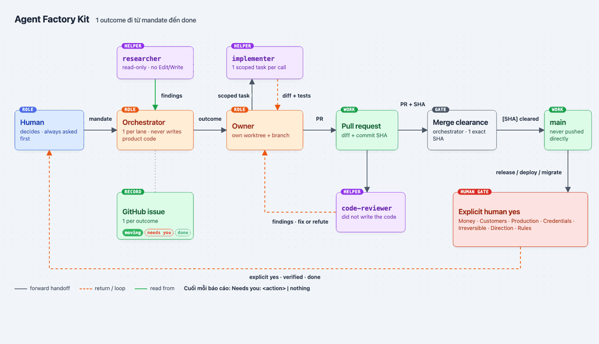

# Solo Software Factory Setup Kit

🇬🇧 [English](README.md)

*Phỏng theo bộ kit [orchestrating-agents](https://github.com/OskarGroth/orchestrating-agents) của Oskar Groth (giấy phép MIT).*

---

> **Ghi chú cho AI Agent:**
> Trước khi thiết lập repository này, hãy hỏi lập trình viên các câu hỏi khởi tạo trong `QUESTIONS.md`. Điều chỉnh mọi vai trò, lane, subagent và quy tắc điều phối theo nhu cầu cụ thể của dự án dựa trên câu trả lời. Không được tự giả định hay đoán thông tin còn thiếu.
>
> **Lưu ý về AGENTS.md trong Claude Code:**
> Claude Code (v2.1.277+) chỉ đọc trực tiếp `AGENTS.md` khi không có `CLAUDE.md`, `.claude/CLAUDE.md` hoặc `CLAUDE.local.md` trong thư mục làm việc hay bất kỳ thư mục cha nào (`~/.claude/CLAUDE.md`, CLAUDE.md do tổ chức quản lý và `.claude/rules/` không chặn việc này). Ở một số phiên Claude không đọc được `AGENTS.md` trực tiếp; khi đó hãy import nó từ `CLAUDE.md`. Kiểm tra cả ba file: nếu có file nào tồn tại, thêm dòng `@AGENTS.md` vào đó (không xóa nội dung cũ); nếu không có file nào, dùng `AGENTS.md` trực tiếp và xác nhận khi bắt đầu phiên rằng nó đã được nạp (Claude hiện dòng như "AGENTS.md loaded"). Xem `SETUP.md`.

---

## Tổng quan

Kit này cung cấp các template và quy tắc để dựng một "nhà máy phần mềm một người" tự động, vận hành bởi AI coding agent (Claude Code hoặc OpenAI Codex).

Người vận hành chính các file này là **phiên AI agent chính** của bạn, đóng vai orchestrator của lane.

### Cấu trúc repository
- `README.md`: Bản tiếng Anh của file này.
- `README_VI.md`: File này. Kiến trúc tổng quan và quickstart.
- `SETUP.md`: Quy trình thiết lập từng bước do agent thực hiện.
- `QUESTIONS.md`: Bộ câu hỏi khởi tạo bắt buộc, phải hỏi trước khi tạo bất kỳ file nào.
- `ORCHESTRATION-RULES.md`: Quy tắc cốt lõi về trạng thái task, cô lập branch, review độc lập, cấp phép merge và ranh giới chuyển lên con người.
- `AGENTS.md`: Chuỗi chỉ dẫn dùng chung cho Claude Code và Codex: hành vi orchestrator, các phiên owner và cơ chế riêng của từng công cụ.
- `SOURCES.md`: Dấu vết kiểm toán, nối mọi quy tắc, cờ và khóa cấu hình tới tài liệu gốc.
- `.claude/agents/`: Ví dụ định nghĩa subagent cho Claude Code (`code-reviewer.md`, `implementer.md`, `researcher.md`).
- `.codex/`: Cấu hình và định nghĩa subagent cho Codex (`config.toml`, `agents/code-reviewer.toml`, `agents/implementer.toml`).
- `diagrams/agent-factory-kit.html`: Sơ đồ hệ thống có animation của kit (file `.gif` là bản xem trước trong README).

---

## Sơ đồ

Sơ đồ hệ thống của nhà máy (orchestrator, owner, helper subagent, luồng review và merge):

- [Mở file sơ đồ có animation](diagrams/agent-factory-kit.html)
- [**Xem trực tiếp trên trình duyệt**](https://htmlpreview.github.io/?https://github.com/nhathvv/agent-factory-kit/blob/main/diagrams/agent-factory-kit.html)

---

## Quickstart

1. Chép các file này vào thư mục gốc của repository dự án.
2. Khởi động phiên agent chính:
   - **Với Claude Code:** chạy `claude` rồi nhập:
     `Read SETUP.md, ask me the questions in QUESTIONS.md, and initialize the orchestration system.`
   - **Với Codex:** chạy `codex` rồi nhập:
     `Read SETUP.md, ask me the questions in QUESTIONS.md, and initialize the orchestration system.`
3. Trả lời bộ câu hỏi. Agent được chỉ thị nghiêm ngặt phải dừng lại cho đến khi bạn trả lời đầy đủ.
4. Agent sẽ điều chỉnh quy tắc, rà soát quyền, cấu hình subagent theo nền tảng và dẫn bạn qua một task nền tảng từ đầu đến cuối.
